# 데이터 탐색, 통계적 추론과 단순 선형 회귀의 원리

- **작성일**: 2026-11-24
- **참고 실습 노트북**: [prac.ipynb](./prac.ipynb)
- **관련 데이터셋**: [usa_housing.csv](./datasets/usa_housing.csv), [office.csv](./datasets/office.csv)

---

## 1. 데이터 분석의 기초: 데이터 구조와 시각화 원리

### 1.1. 학습 전체 로드맵

데이터 분석과 머신러닝 회귀 모델링은 단순히 코드를 실행하는 작업이 아니라, **데이터의 구조를 파악하고 통계적 관계를 검증한 뒤 수학적 모델로 근사하고 그 오차를 평가하는 일련의 과학적 과정**이다. 전체 흐름은 다음 다섯 단계로 이어진다.

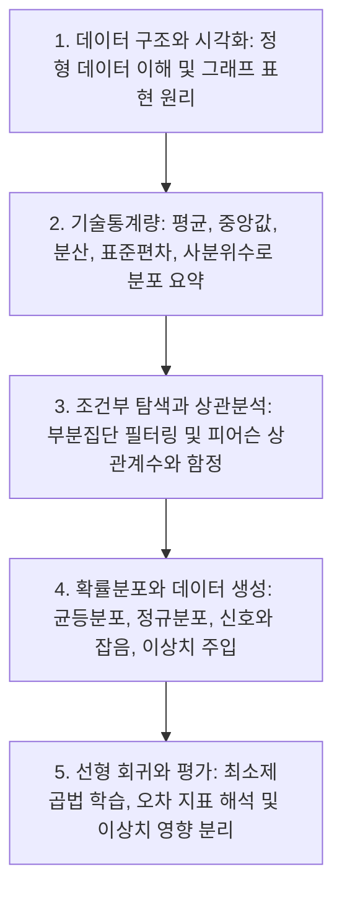

---

### 1.2. 정형 데이터(Tabular Data)의 구조와 변수의 유형

현실 세계의 많은 데이터는 행과 열로 이루어진 2차원 표 형태의 **정형 데이터**(Tabular Data)로 저장된다. 데이터 분석에서 행과 열은 각각 고유한 의미를 가진다.

- **행(Row, 관측치 또는 샘플)**: 분석 대상이 되는 개별 객체 하나를 뜻한다. 주택 데이터라면 한 채의 집이 하나의 행에 해당한다.
- **열(Column, 변수 또는 특성/피처)**: 각 객체를 설명하는 속성이다. 머신러닝에서는 입력으로 쓰는 열을 **특성**(Feature), 예측하려는 목표 열을 **타깃**(Target)이라 부른다.

표 안의 변수는 숫자가 담겼다고 해서 모두 같은 성격을 띠지 않으며, 크게 **연속형 변수**와 **식별자/범주형 변수**로 구분한다.

| 변수 유형 | 정의 | 예시 (`usa_housing.csv`) | 주의점 |
| :--- | :--- | :--- | :--- |
| **연속형(수치형) 변수** | 크고 작음의 비교와 사칙연산(평균, 차이)이 의미 있는 숫자 | `Price`, `SquareFeet`, `CrimeRate`, `LotSize`, `Bathrooms` | 거리나 비례 관계를 수학 모델에 직접 투입 가능하다. |
| **이산형(카운트) 변수** | 정수 단위로 개수를 헤아리는 수치 | `Bedrooms`, `GarageSpaces`, `YearBuilt`, `SchoolRating` | 연속형에 준해 다루거나 순서형으로 해석한다. |
| **식별자/범주형 변수** | 대상을 구분하거나 소속 그룹을 표시하는 코드 | `ZipCode`(우편번호) | 겉보기엔 숫자지만 크고 작음이나 평균 계산이 무의미하므로 그대로 회귀식에 넣으면 안 된다. |

이러한 정형 데이터를 텍스트 파일로 가장 널리 주고받는 형식이 **CSV**(Comma-Separated Values, 쉼표로 값을 구분한 파일)이다. 파일 경로를 지정할 때 맨 앞에 붙이는 `./`는 현재 작업 디렉터리를 의미하는 **상대 경로** 표기이며, 어느 환경에서 프로젝트를 실행해도 폴더 구조만 같으면 파일을 불러올 수 있게 한다.

실습에 사용하는 `usa_housing.csv`를 불러와 `shape` 속성을 확인하면 `(300, 10)`이 출력된다. 이는 **300채의 주택 관측치**와 **10개의 특성**(`Price`, `Bedrooms`, `Bathrooms`, `SquareFeet`, `YearBuilt`, `GarageSpaces`, `LotSize`, `ZipCode`, `CrimeRate`, `SchoolRating`)으로 구성된 표라는 뜻이다.

```python
import pandas as pd

house = pd.read_csv("./datasets/usa_housing.csv")
print(house.shape)  # (300, 10)
```

---

### 1.3. 데이터 시각화의 목적과 차트 선택 원리

표에 담긴 수백 개의 숫자를 눈으로만 읽어서는 전체 추세나 숨어 있는 예외를 파악하기 어렵다. **데이터 시각화**(Data Visualization)는 수치 정보를 위치, 길이, 색상 같은 시각적 요소로 번역하여 **패턴, 추세, 밀집도, 이상치**를 직관적으로 포착하기 위해 사용한다.

데이터의 성격과 확인하려는 질문에 따라 적절한 차트를 골라야 한다.

- **선 그래프(Line Plot)**: X축이 시간이나 순서처럼 연속적인 흐름을 가질 때 값의 **변화 추이**를 보기 위해 사용한다. 각 데이터 지점에 점(`marker`)을 함께 찍으면 개별 시점의 정확한 위치와 전체 기울기를 동시에 읽을 수 있다.
- **산점도(Scatter Plot)**: 두 개의 연속형 변수(예: 면적과 가격)를 각각 X축과 Y축에 대응시켜 평면 위의 점으로 나타낸다. 두 변수가 **함께 증가하거나 감소하는지(상관관계), 데이터가 어디에 몰려 있는지, 전체 흐름에서 크게 벗어난 이상치가 있는지**를 탐색할 때 가장 기본이 되는 도구이다.

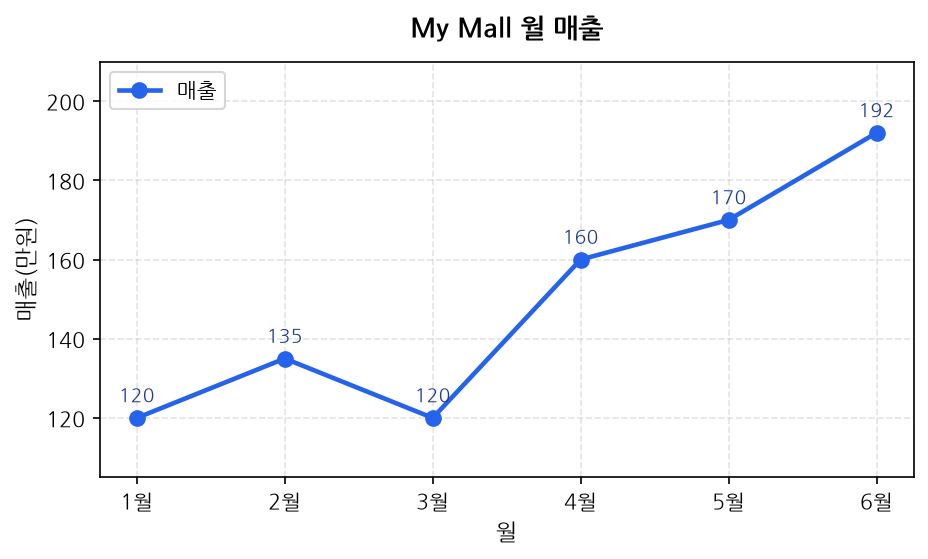

---

### 1.4. 파이썬 데이터 분석 생태계와 Matplotlib 계층 구조

파이썬 데이터 분석 환경은 역할이 분담된 네 개의 핵심 라이브러리 조합을 기반으로 동작한다.

| 라이브러리 | 관례적 별칭 | 핵심 역할과 내부 구조 |
| :--- | :--- | :--- |
| `numpy` | `np` | C 기반의 연속 메모리 배열(`ndarray`)을 사용해 고속 벡터 연산, 선형대수, 난수 생성을 담당한다. |
| `pandas` | `pd` | NumPy 위에 1차원 `Series`와 2차원 `DataFrame`을 구축해 열 이름 기반 조회, 필터링, 통계 요약을 제공한다. |
| `matplotlib.pyplot` | `plt` | 파이썬 표준 2D 그래프 라이브러리로, 도화지와 좌표축의 모든 세부 요소를 제어한다. |
| `seaborn` | `sns` | Matplotlib을 기반으로 통계적 분포와 관계 그래프를 간결한 문법으로 그려 주는 고수준 시각화 도구이다. |

Matplotlib은 내부적으로 **도화지**(`Figure`) 안에 **좌표평면**(`Axes`)이 들어가는 계층 구조를 따른다. `figsize=(6, 3)`은 가로 6인치, 세로 3인치의 물리적 크기를 뜻하며, 기본 해상도 100 DPI 환경에서는 `600 x 300` 픽셀 크기의 `Figure` 객체가 생성된다.

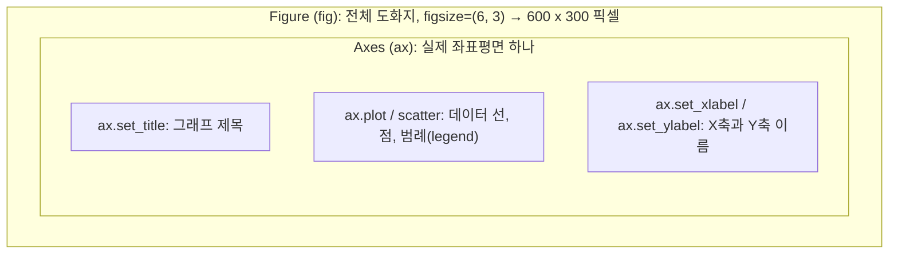

Matplotlib으로 그래프를 작성하는 방식에는 두 가지 인터페이스가 존재한다.

1. **객체 지향(Object-Oriented) 인터페이스**: `fig, ax = plt.subplots()`로 도화지와 좌표축 객체를 직접 받아 `ax.plot()`, `ax.set_title()`, `ax.set_xlabel()`, `ax.set_ylabel()`, `ax.legend()`처럼 대상 축을 명시해 조작한다. 한 도화지 안에 여러 그래프를 배치하거나 정교하게 제어할 때 유리하다.
2. **상태 기반(Stateful, `pyplot`) 인터페이스**: `plt.figure()`로 도화지를 연 뒤 `plt.scatter()`, `plt.title()`, `plt.xlabel()`, `plt.ylabel()`, `plt.legend()`처럼 "현재 활성화된 그래프"에 명령을 순차적으로 내린다. 단일 그래프를 빠르게 탐색할 때 코드가 간결하다.

또한 한글 텍스트와 음수 기호가 깨지는 문제를 막으려면 전역 설정 객체인 `plt.rcParams`를 먼저 지정해야 한다.

- `plt.rcParams['font.family'] = "NanumGothic"`: 기본 영문 글꼴 대신 한글을 지원하는 글꼴을 지정해 글자가 네모(`□`)로 깨지는 현상을 방지한다.
- `plt.rcParams['axes.unicode_minus'] = False`: 일부 한글 글꼴에 유니코드 마이너스 기호(`U+2212`)가 빠져 있어 음수 눈금이 깨지는 문제를 피하기 위해 일반 ASCII 하이픈(`-`)을 사용하도록 강제한다.

```python
import numpy as np
import pandas as pd
import seaborn as sns
import matplotlib.pyplot as plt

plt.rcParams['font.family'] = "NanumGothic"
plt.rcParams['axes.unicode_minus'] = False

fig, ax = plt.subplots(figsize=(6, 3))
months = ["1월", "2월", "3월", "4월", "5월", "6월"]
sales = [120, 135, 120, 160, 170, 192]

ax.plot(months, sales, marker="o", label="매출")
ax.set_title("My Mall 월 매출")
ax.set_xlabel("월")
ax.set_ylabel("매출(만원)")
ax.legend()
plt.show()
```

그래프의 시각적 가독성을 높이는 주요 인자는 다음과 같다.

- `marker="o"`: 선 그래프에서 각 관측 시점의 위치를 원형 마커로 강조한다.
- `alpha`: 점이나 도형의 투명도(`0.0` ~ `1.0`)를 조절해 데이터가 밀집된 구간과 겹침 정도를 식별하게 한다.
- `color`, `s`: 산점도에서 점의 색상(`color`)과 면적 기준 크기(`s`)를 변경해 강조 집단을 시각적으로 분리한다.
- `label`과 `legend()`: 각 계열에 이름을 붙인 뒤 범례 상자를 출력한다. 마지막의 `plt.show()`는 메모리에 구성된 그림을 화면에 최종 렌더링하는 명령이다.

---

## 2. 데이터의 분포를 읽는 힘: 기술통계량(Descriptive Statistics)

수백, 수천 개의 데이터 포인트를 하나의 그림이나 몇 개의 요약 숫자로 압축해 데이터 전체의 생김새를 파악하는 분야를 **기술통계학**(Descriptive Statistics)이라 한다. 데이터 분포는 크게 **중심이 어디인가**(중심 경향성), **얼마나 흩어져 있는가**(산포도), **위치별 경계값은 어떠한가**(분위수)의 세 축으로 요약된다.

### 2.1. 중심 경향성: 평균(Mean)과 중앙값(Median)

데이터 집단을 대표하는 중심값으로 가장 많이 쓰이는 두 지표가 **산술 평균**과 **중앙값**이다.

- **평균(Mean, $\bar{x}$)**: 모든 값을 더해 전체 개수($n$)로 나눈 무게중심이다.

$$\bar{x} = \frac{1}{n} \sum_{i=1}^{n} x_i$$

- **중앙값(Median)**: 데이터를 크기 순서대로 정렬했을 때 정확히 한가운데(상위 50%, 하위 50% 경계)에 위치한 값이다. 개수가 짝수이면 가운데 두 값의 평균을 취한다.

두 지표의 결정적 차이는 **극단적인 값(이상치)에 대한 민감도**이다. 5명의 연봉이 `[3000, 3200, 3500, 3800, 50000]`(단위: 만원)인 경우를 계산하면 그 차이가 명확히 드러난다.

- **평균**: $(3000 + 3200 + 3500 + 3800 + 50000) / 5 = 12,700$만원. 대다수 구성원(3,000만 원대)과 동떨어진 수치로 왜곡된다.
- **중앙값**: 크기 순 정렬 시 가운데 값인 `3,500`만원. 극단값 `50,000`이 아무리 커져도 영향을 받지 않는다.

따라서 데이터 분포가 좌우 대칭이면 평균과 중앙값이 비슷하지만, 한쪽으로 긴 꼬리를 가진 비대칭 분포에서는 두 값의 차이가 벌어지며 중앙값이 대다수 집단의 현실을 더 잘 대변한다.

---

### 2.2. 산포도: 분산(Variance)과 표준편차(Standard Deviation)

평균만으로는 데이터가 고르게 모여 있는지, 넓게 흩어져 있는지 알 수 없다. 이를 측정하는 지표가 **산포도**이다.

각 데이터 값과 평균의 차이를 **편차**($x_i - \bar{x}$)라고 한다. 편차를 그대로 모두 더하면 평균보다 큰 양수 편차와 작은 음수 편차가 서로 상쇄되어 항상 `0`이 된다. 이 상쇄 문제를 해결하기 위해 편차를 **제곱**하여 평균 낸 값이 **분산**(Variance)이다. 표본 데이터에서는 자유도 보정을 위해 $n - 1$로 나눈 표본 분산을 표준으로 사용한다.

$$s^2 = \frac{1}{n - 1} \sum_{i=1}^{n} (x_i - \bar{x})^2$$

분산은 오차를 제곱했기 때문에 원래 단위가 제곱 단위(예: 만원²)로 바뀌어 직관적인 크기 해석이 어렵다. 분산에 양의 제곱근($\sqrt{\phantom{x}}$)을 씌워 **원래 데이터와 동일한 단위**로 복원한 지표가 **표준편차**(Standard Deviation, $s$)이다.

$$s = \sqrt{\frac{1}{n - 1} \sum_{i=1}^{n} (x_i - \bar{x})^2}$$

표준편차가 작다는 것은 데이터가 평균 주변에 촘촘히 모여 있음을 의미하고, 표준편차가 크다는 것은 데이터 간 편차가 크고 넓게 퍼져 있음을 뜻한다.

---

### 2.3. 분위수와 사분위수(Quartiles): 분포의 뼈대 읽기

평균과 표준편차가 수치 합산에 기반한 요약이라면, **분위수**(Quantile)는 데이터를 크기 순으로 줄 세웠을 때 **순서와 비율에 따른 위치**로 분포를 파악하는 방법이다. 특히 전체를 4등분하는 지점을 **사분위수**(Quartiles)라 부른다.

- **최솟값 (`min`, 0%)**: 정렬된 데이터 중 가장 작은 값이다.
- **제1사분위수 (`25%`, $Q_1$)**: 하위 25% 지점에 해당하는 값이다.
- **제2사분위수 (`50%`, $Q_2$)**: 하위 50% 지점으로, 곧 **중앙값**(Median)과 같다.
- **제3사분위수 (`75%`, $Q_3$)**: 하위 75% 지점(상위 25% 경계)에 해당하는 값이다.
- **최댓값 (`max`, 100%)**: 정렬된 데이터 중 가장 큰 값이다.
- **사분위 범위 ($\text{IQR} = Q_3 - Q_1$)**: 데이터의 한가운데 50%가 차지하는 구간의 폭이다. 양쪽 끝 25%씩의 극단값을 배제한 범위이므로 이상치의 영향을 받지 않는 강건한 산포 지표로 쓰인다.

---

### 2.4. 실전 요약 해석과 데이터 저장

뒤에서 생성할 가상 오피스텔 데이터 200건(`office`)에 대해 Pandas의 `describe()` 메서드를 실행하면 수치형 변수별 8가지 기술통계량이 산출된다.

| 통계량 | 의미 | `area` (㎡) 결과 | `price` (만원) 결과 | 분포 해석 |
| :--- | :--- | ---: | ---: | :--- |
| `count` | 결측치 제외 개수 | `200.000000` | `200.000000` | 두 변수 모두 결측치 없이 200건이 온전하다. |
| `mean` | 산술 평균 | `52.818887` | `29138.400000` | `area` 평균은 균등 구간 `[20, 85)`의 중심 `52.5`에 근접한다. |
| `std` | 표준편차 | `18.585307` | `9112.092603` | 면적 대비 가격의 변동 폭이 크며, 일부 극단값이 표준편차를 키운다. |
| `min` | 최솟값 | `22.044632` | `11400.000000` | 최소 면적은 약 22.0㎡, 최저 가격은 11,400만 원이다. |
| `25%` | 제1사분위수 ($Q_1$) | `37.420928` | `21615.000000` | 하위 25% 매물의 가격은 21,615만 원 이하에 위치한다. |
| `50%` | 중앙값 ($Q_2$) | `51.980202` | `28965.000000` | `price` 중앙값(`28,965`)보다 평균(`29,138.4`)이 약간 크다. |
| `75%` | 제3사분위수 ($Q_3$) | `67.426136` | `36377.500000` | 중앙 50% 구간의 폭($\text{IQR}$)은 `14,762.5`만 원이다. |
| `max` | 최댓값 | `84.921096` | `58460.000000` | $Q_3$(`36,377.5`)에서 `max`(`58,460`)까지 거리가 유독 멀어 고가 이상치 존재를 시사한다. |

이 가격 분포의 히스토그램과 상자그림(Boxplot)을 나란히 겹쳐 보면 평균, 중앙값, 사분위수, 그리고 오른쪽 끝으로 길게 뻗은 이상치 꼬리의 위치가 시각적으로 명확히 드러난다.

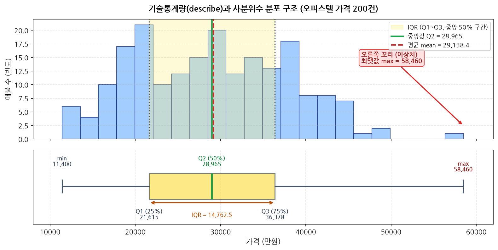

정제한 DataFrame을 다시 CSV 파일로 저장할 때는 `office.to_csv("./datasets/office.csv", index=False)`처럼 `index=False`를 지정한다. Pandas DataFrame은 내부적으로 `0, 1, 2, ...` 형태의 행 인덱스를 항상 가지는데, `index=False`를 생략하면 이 행 번호가 별도의 열로 파일에 기록되어 추후 파일을 다시 읽어 들일 때 `Unnamed: 0`이라는 불필요한 열이 생기기 때문이다.

---

## 3. 조건부 탐색과 상관관계 분석(Correlation Analysis)

### 3.1. 부분집단 탐색과 불리언 논리(Boolean Logic)

전체 데이터를 하나의 덩어리로만 요약하면 서로 다른 성격의 하위 집단이 섞여 본질적인 패턴이 가려질 수 있다. 따라서 분석에서는 특정 조건을 만족하는 **부분집단**(Subset)을 분리해 관찰하는 조건부 탐색이 필수적이다.

표에서 원하는 조건의 행만 골라내는 핵심 메커니즘이 **불리언 인덱싱**(Boolean Indexing)이다. 각 행이 조건을 만족하면 `True`, 만족하지 않으면 `False`를 가지는 참/거짓 배열(마스크)을 먼저 만든 뒤, 이를 표의 인덱스로 전달하여 `True` 위치의 행만 추출한다.

예를 들어 4채의 주택에 `"2015년 초과 건축"`과 `"범죄율 40 미만"`이라는 두 조건을 동시에(AND) 적용하는 과정은 다음과 같다.

| 행 인덱스 | `YearBuilt` | `CrimeRate` | 조건1 (`YearBuilt > 2015`) | 조건2 (`CrimeRate < 40`) | `조건1 & 조건2` | 추출 여부 |
| :---: | :---: | :---: | :---: | :---: | :---: | :---: |
| 0 | 1995 | 25 | `False` | `True` | **`False`** | 제외 |
| 1 | 2018 | 15 | `True` | `True` | **`True`** | **포함** |
| 2 | 2020 | 60 | `True` | `False` | **`False`** | 제외 |
| 3 | 2010 | 35 | `False` | `True` | **`False`** | 제외 |

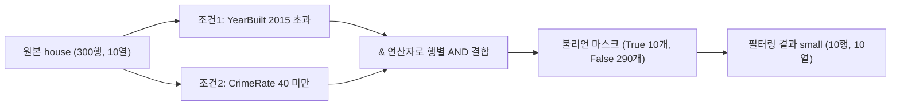

```python
small = house[(house["YearBuilt"] > 2015) & (house["CrimeRate"] < 40)]
print(small.shape)  # (10, 10)
```

파이썬 데이터 프레임에서 다중 조건을 결합할 때는 두 가지 문법 원리를 반드시 지켜야 한다.

1. **`and` 대신 비트 논리 연산자 `&` 사용**: 파이썬 내장 키워드 `and`는 단일 참/거짓 값 하나를 평가하도록 설계되어 있다. 수백 개의 불리언 원소가 담긴 Series에 `and`를 적용하면 전체를 하나의 참/거짓으로 환원할 수 없어 `ValueError`가 발생한다. 따라서 원소별로 짝을 맞추어 연산하는 `&`(AND), `|`(OR), `~`(NOT)을 사용해야 한다.
2. **소괄호 `()`로 각 조건 감싸기**: 파이썬 연산자 우선순위 규칙상 `&` 연산자가 비교 연산자(`>`, `<`)보다 먼저 결합된다. 괄호 없이 `house["YearBuilt"] > 2015 & house["CrimeRate"] < 40`이라 쓰면 `2015 & house["CrimeRate"]`부터 계산하려다 오류가 발생하므로, 반드시 `(조건1) & (조건2)` 형태로 우선순위를 명시해야 한다.

---

### 3.2. 공분산(Covariance)에서 피어슨 상관계수($r$)까지

두 연속형 변수 $X$와 $Y$가 얼마나 함께 움직이는지 수치로 측정하기 위해 먼저 **공분산**(Covariance) 개념에서 출발한다.

$$\text{Cov}(X, Y) = \frac{1}{n - 1} \sum_{i=1}^{n} (x_i - \bar{x})(y_i - \bar{y})$$

공분산의 부호는 두 변수의 변화 방향을 알려 준다.

- $x$가 평균보다 클 때($x_i - \bar{x} > 0$) $y$도 평균보다 크다면($y_i - \bar{y} > 0$), 두 편차의 곱은 **양수**가 된다.
- 반대로 $x$가 클 때 $y$가 평균보다 작아진다면, 두 편차의 곱은 **음수**가 된다.
- 두 변수가 무작위로 섞여 양수 항과 음수 항이 비슷하게 나오면 합이 `0` 근처로 상쇄된다.

그러나 공분산은 **측정 단위에 따라 크기가 달라진다**는 치명적 한계가 있다. 예를 들어 면적 단위를 제곱피트에서 제곱미터로 바꾸거나 가격을 원에서 만원으로 바꾸면 공분산 숫자 자체가 수천 배 변하므로, 값만 보고 관계가 강한지 약한지 절대적 판단을 내릴 수 없다.

이 단위 의존성 문제를 해결하기 위해 공분산을 각 변수의 표준편차($s_x, s_y$)의 곱으로 나누어 크기를 정규화한 지표가 **피어슨 상관계수**(Pearson Correlation Coefficient, $r$)이다.

$$r = \frac{\text{Cov}(X, Y)}{s_x s_y} = \frac{\sum_{i=1}^{n} (x_i - \bar{x})(y_i - \bar{y})}{\sqrt{\sum_{i=1}^{n} (x_i - \bar{x})^2} \sqrt{\sum_{i=1}^{n} (y_i - \bar{y})^2}}$$

표준화 과정을 거쳤기 때문에 피어슨 상관계수는 단위와 무관하게 **항상 `-1`에서 `+1` 사이의 값**을 가진다.

| 상관계수 $r$ 구간 | 관계의 방향과 강도 해석 |
| :--- | :--- |
| `+0.7 ~ +1.0` | 강한 양의 선형 관계 ($x$가 커질수록 $y$도 뚜렷하게 커짐) |
| `+0.3 ~ +0.7` | 중간 정도의 양의 선형 관계 |
| `-0.3 ~ +0.3` | 선형 관계가 매우 약하거나 거의 없음 (`0`에 가까울수록 직선 패턴 부재) |
| `-0.7 ~ -0.3` | 중간 정도의 음의 선형 관계 |
| `-1.0 ~ -0.7` | 강한 음의 선형 관계 ($x$가 커질수록 $y$는 뚜렷하게 작아짐) |

---

### 3.3. 상관분석의 4가지 핵심 함정과 실제 주택 데이터 검증

피어슨 상관계수는 매우 강력한 요약 도구이지만, 숫자 하나만 맹신하면 심각한 오판에 빠질 수 있다. 상관분석을 해석할 때는 다음 네 가지 핵심 함정을 반드시 점검해야 한다.

#### 3.3.1. 함정 1: 직선(선형) 관계만 측정하는 한계

피어슨 상관계수는 오직 **일직선 형태의 관계**만 감지한다. 아래 그림의 네 번째 패널처럼 $y = x^2 - 3$ 같은 완벽한 U자 곡선 관계가 존재하더라도, 왼쪽 절반의 음의 기울기와 오른쪽 절반의 양의 기울기가 서로 상쇄되어 실제 계산된 상관계수는 `r = +0.03`으로 `0`에 가깝게 나온다. 따라서 상관계수를 계산하기 전에는 반드시 **산점도로 실제 분포 모양을 눈으로 확인**해야 한다.

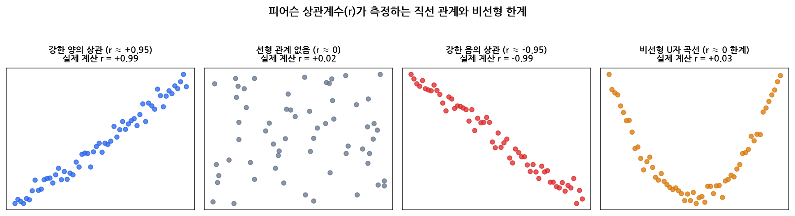

#### 3.3.2. 함정 2: 상관관계와 인과관계의 혼동

상관계수가 높다는 것은 두 변수가 **함께 변하는 경향**이 있다는 통계적 사실일 뿐, 한쪽이 다른 쪽을 일으키는 **원인과 결과**(인과관계)임을 증명하지 않는다. 여름철에 아이스크림 판매량과 물놀이 익사 사고 건수가 높은 양의 상관을 보이더라도 아이스크림이 사고의 원인이 아니며, 둘 다 "기온 상승"이라는 제3의 요인에 의해 함께 증가한 결과이다.

#### 3.3.3. 함정 3: 교란 변수(Confounding Variable)와 집단 혼합

실제 주택 데이터 `usa_housing.csv`에서 주거 면적(`SquareFeet`)과 주택 가격(`Price`)의 상관계수를 계산해 `round(값, 2)`로 반올림하면 놀라운 대조가 나타난다.

```python
print("전체 300채의 상관계수:", round(house["SquareFeet"].corr(house["Price"]), 2))  # 0.08
print("10채의 상관계수:", round(small["SquareFeet"].corr(small["Price"]), 2))       # 0.89
```

```python
plt.figure(figsize=(10, 5))
plt.scatter(house["SquareFeet"], house["Price"], alpha=0.4, label="전체 300채")
plt.scatter(small["SquareFeet"], small["Price"], color="red", s=50, label="2015년 이후 건축")
plt.xlabel("면적")
plt.ylabel("가격")
plt.legend()
plt.show()
```

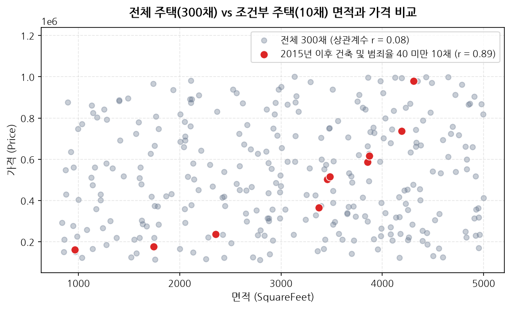

- **전체 300채 (`r = 0.08`)**: 면적과 가격 사이에 직선 관계가 사실상 보이지 않는다. 실제 주택 시장에서는 면적 외에도 건축 연도, 범죄율, 학군 등 다양한 요인이 가격을 강하게 좌우한다. 이처럼 관심 있는 두 변수 모두에 개입해 본래의 관계를 가리거나 왜곡하는 숨은 제3의 변수를 **교란 변수**(Confounding Variable)라 한다. 오래되고 범죄율이 높은 지역의 대형 주택은 싸게 거래되고, 반대로 신축에 안전한 지역의 소형 주택은 비싸게 거래되면서 전체 집단에서는 면적 효과가 희석되었다.
- **조건부 10채 (`r = 0.89`)**: 건축 연도(`YearBuilt > 2015`)와 치안(`CrimeRate < 40`)이라는 조건을 통제하여 동질적인 주택만 모으니, 비로소 **"면적이 넓을수록 가격이 비싸진다"는** 순수한 양의 선형 관계(`0.89`)가 드러난다.

#### 3.3.4. 함정 4: 소표본 편향(Small Sample Bias)

동시에, 조건을 과도하게 좁혀 표본 수($n$)가 극도로 작아지면 새로운 위험이 생긴다. 표본이 10개뿐인 상황에서는 통계적 변동성이 매우 크기 때문에, 우연히 몇 개의 점이 대각선 근처에 배치되거나 극단값 한두 개가 포함되는 것만으로도 상관계수가 실제 모집단보다 훨씬 높게 부풀려질 수 있다. 따라서 조건 통제로 높은 상관을 발견했더라도 표본 수가 적을 때는 잠정적 가설로 받아들이고 더 많은 데이터로 검증해야 한다.

---

## 4. 확률분포와 데이터 생성 모델: 합성 데이터와 이상치

### 4.1. 합성 데이터(Synthetic Data) 실험과 의사난수, 시드(Seed)

현실 데이터만으로는 머신러닝 모델이 찾아낸 규칙이 진짜 정답과 얼마나 일치하는지 확인하기 어렵다. 실제 세상의 정확한 수식(정답 파라미터)은 감춰져 있기 때문이다. 반대로 우리가 **정답 규칙을 미리 정해 놓고 직접 만든 가상 데이터**, 즉 **합성 데이터**(Synthetic Data)를 사용하면 모델이 정답을 얼마나 잘 복원하는지, 노이즈와 이상치가 모델에 어떤 왜곡을 일으키는지 정밀하게 통제하며 실험할 수 있다.

합성 데이터를 생성할 때 핵심 도구가 컴퓨터의 **의사난수 생성기**(Pseudo-Random Number Generator, RNG)이다. 컴퓨터가 만드는 난수는 완전한 우연이 아니라 특정 초깃값에서 출발해 정해진 결정론적 수학 알고리즘이 뿜어내는 숫자열이다.

- **`np.random.default_rng(40)`**: 최신 NumPy가 권장하는 `Generator` 기반 난수 생성기를 초기화한다. 여기서 `40`이 난수 수열의 시작점을 결정하는 **시드**(Seed)이다.
- **재현성(Reproducibility)**: 동일한 시드 번호(`40`)와 동일한 함수 호출 순서(`uniform` -> `normal` -> `choice` -> `uniform`)를 유지하면, 언제 어디서 코드를 다시 실행해도 **완전히 동일한 난수 시퀀스**를 얻을 수 있다. 이는 과학적 실험 결과를 다른 사람이 그대로 검증할 수 있게 만드는 핵심 원리이다.

---

### 4.2. 확률분포의 이해: 연속 균등분포 vs 정규분포

**확률분포**(Probability Distribution)란 어떤 확률 변수가 가질 수 있는 모든 값과 각 값이 나타날 가능성(확률 또는 확률 밀도)의 분포 구조를 뜻한다. 가상 오피스텔 데이터 200건(`n = 200`)에서는 성격이 전혀 다른 두 가지 연속 확률분포가 사용된다.

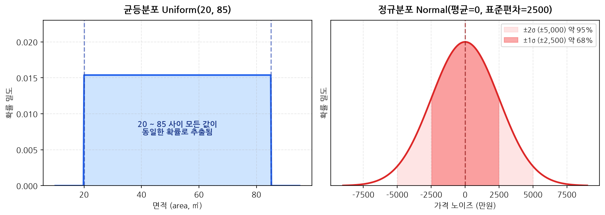

1. **연속 균등분포 (Continuous Uniform Distribution)**
   - 지정한 구간 $[a, b)$ 안의 모든 실수가 **어느 위치에서도 똑같은 확률 밀도**를 가지는 직사각형 모양의 분포이다.
   - 오피스텔 면적을 특정 크기대에 치우치지 않고 `20㎡`부터 `85㎡` 미만까지 고르게 분포시키기 위해 `area = rng.uniform(20, 85, n)`으로 생성한다.

2. **정규분포 (Normal Distribution / Gaussian Distribution)**
   - 평균($\mu$, `loc`)을 중심으로 좌우가 대칭이며, 평균 근처에 데이터가 가장 많이 모이고 양끝으로 갈수록 빈도가 급격히 줄어드는 종(Bell) 모양의 분포이다. 자연 현상과 사회 현상의 무수한 독립적 오차들이 합쳐질 때 중심극한정리에 의해 정규분포로 수렴하는 성질이 있어, 현실적인 무작위 오차(노이즈)를 모사하는 표준 분포로 쓰인다.
   - 분포의 퍼진 정도는 표준편차($\sigma$, `scale`)가 결정하며, 정규분포는 다음과 같은 **68-95-99.7 경험 법칙**을 따른다.
     - 전체 데이터의 약 **68%가** $\mu \pm 1\sigma$ 구간 안에 놓인다.
     - 전체 데이터의 약 **95%가** $\mu \pm 2\sigma$ 구간 안에 놓인다.
     - 전체 데이터의 약 **99.7%가** $\mu \pm 3\sigma$ 구간 안에 놓인다.
   - `rng.normal(0, 2500, n)`은 평균 `0`, 표준편차 `2,500`인 정규분포에서 200개의 오차를 뽑는다. 따라서 약 68%의 매물은 기준 직선 대비 `±2,500`만 원 이내에, 약 95%는 `±5,000`만 원 이내에 퍼지게 된다.

---

### 4.3. 신호(Signal)와 잡음(Noise): 현실 데이터의 생성 구조

통계학과 머신러닝에서는 관측되는 현실 데이터를 **신호**(Signal)와 **잡음**(Noise)의 합으로 모델링한다.

$$y = f(x) + \varepsilon$$

- **신호 ($f(x) = wx + b$)**: 입력 변수 $x$ (**독립변수**, 면적)가 출력 변수 $y$ (**종속변수**, 가격)에 미치는 규칙적이고 구조적인 관계이다. 오피스텔 시세 모델에서는 진짜 **기울기**(가중치) $w = 450$, 진짜 **절편**(편향) $b = 5000$으로 설정한다. 즉, 면적이 `1㎡` 증가할 때마다 가격이 `450`만 원씩 상승하는 규칙이다.
- **잡음 ($\varepsilon \sim \mathcal{N}(0, 2500^2)$)**: 면적만으로는 설명할 수 없는 수많은 미관측 요인(층수, 방향, 역세권 거리, 인테리어, 매도자의 급매 사정 등)이 만들어 내는 불가피한 무작위 변동이다.

예를 들어 면적이 `50㎡`인 오피스텔 한 채의 가격은 다음 과정으로 결정된다.
1. 신호 계산: $50 \times 450 + 5000 = 27,500$만 원
2. 잡음 결합: 여기에 평균 `0`, 표준편차 `2,500`에서 추출된 랜덤 오차(예: `-1,234.5`만 원)가 더해져 `26,265.5`만 원이 된다.
3. 단위 반올림: `.round(-1)`을 적용해 가격 끝자리를 깔끔한 10만 원 단위로 맞춘다.

```python
rng = np.random.default_rng(40)
n = 200
area = rng.uniform(20, 85, n)
price = (area * 450 + 5000 + (rng.normal(0, 2500, n))).round(-1)
```

NumPy와 Pandas의 `.round(decimals)`에서 **음수 자릿수**는 정수부의 반올림 자릿수를 지정한다.

| 메서드 호출 | 동작 설명 | 입력 `37253.4`의 결과 |
| :--- | :--- | ---: |
| `.round(1)` | 소수 둘째 자리에서 반올림해 소수 첫째 자리까지 유지 | `37253.4` |
| `.round(0)` | 소수 첫째 자리에서 반올림해 일의 자리까지 유지 | `37253.0` |
| **`.round(-1)`** | **일의 자리에서 반올림해 10의 배수(십의 자리 단위)까지 유지** | **`37250.0`** |
| `.round(-2)` | 십의 자리에서 반올림해 100의 배수(백의 자리 단위)까지 유지 | `37300.0` |

실습 노트북의 주석에는 "십의 자리에서 반올림"으로 표현되어 있으나, 실제 계산 결과(`37250.`, `37210.`, `39420.`)가 모두 `10`의 배수로 떨어지므로 `.round(-1)`의 정확한 수학적 동작은 **일의 자리를 반올림하여 십의 자리 단위까지 남기는 것**이다.

---

### 4.4. 표본 추출(Sampling)의 원리와 이상치(Outlier) 주입

모집단에서 일부 원소를 뽑아내는 **표본 추출**(Sampling)에는 두 가지 기본 방식이 있다.

- **복원 추출 (`replace=True`)**: 뽑은 원소를 확인한 뒤 다시 모집단에 되돌려 놓고 다음 원소를 뽑는다. 같은 원소가 여러 번 중복 선택될 수 있다.
- **비복원 추출 (`replace=False`)**: 한 번 뽑은 원소는 다시 넣지 않으므로 모든 선택 결과가 서로 다르게(중복 없이) 추출된다.

현실의 부동산 시장에는 일반적인 시세 선형식과 무관하게 유독 비싸게 나온 극단적 매물(예: 최고급 펜트하우스, 특수 상권 인접 등)이 소수 존재할 수 있다. 이처럼 나머지 대다수 데이터의 분포 패턴에서 현저히 동떨어진 관측치를 **이상치**(Outlier)라 한다. 이상치는 크게 두 가지 경로로 발생한다.

1. **데이터 오류**: 측정 실수, 단위 오기, 입력 오타 등 제거하거나 교정해야 하는 노이즈.
2. **실제 특이 현상**: 사기 거래, 초고가 특수 매물 등 실제 현실에서 드물게 발생하는 고유의 예외 사례.

합성 오피스텔 데이터에서는 200건 중 **중복 없는 5개 인덱스**를 비복원 추출로 고른 뒤(`special = [53, 13, 2, 92, 71]`), 팬시 인덱싱(정수 인덱스 배열을 대괄호에 넣어 여러 위치를 동시 선택하는 기법)과 복합 대입 연산(`+=`)을 이용해 해당 5건의 가격에만 `15,000` ~ `25,000`만 원의 균등분포 프리미엄을 강제로 더한다.

```python
special = rng.choice(n, 5, replace=False)  # array([53, 13, 2, 92, 71])
price[special] += rng.uniform(15000, 25000, 5).round(-1)
office = pd.DataFrame({"area": area, "price": price})
office.to_csv("./datasets/office.csv", index=False)
```

완성된 200건의 가상 오피스텔 데이터로 산점도를 그려 보면 대다수 정상 매물 195건이 우상향하는 직선 띠를 형성하고, 그 위쪽 허공에 5건의 특이 매물(`#13`, `#53`, `#71`, `#92`, `#2`)이 뚜렷하게 분리되어 나타난다. 전체 피어슨 상관계수는 약 **`0.8963`**(`0.8963336215680755`)으로 강한 양의 선형 관계를 보인다.

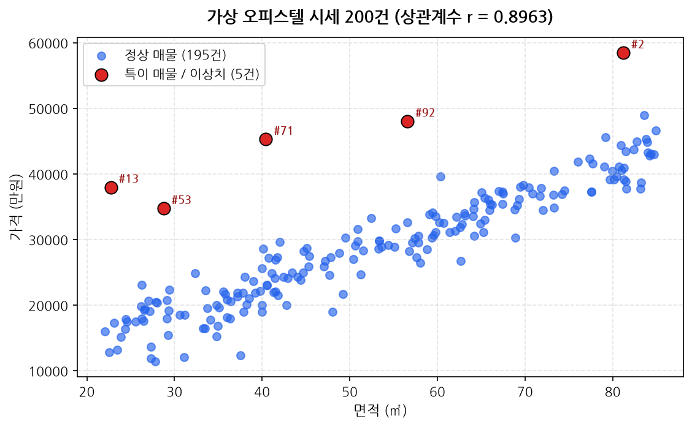

---

## 5. 지도학습과 단순 선형 회귀(Simple Linear Regression)

### 5.1. 머신러닝의 분류와 회귀(Regression) 문제

**머신러닝**(Machine Learning)은 사람이 일일이 규칙을 코딩(`if ... else ...`)하는 대신, 컴퓨터가 데이터로부터 스스로 패턴과 규칙을 학습해 새로운 입력에 대한 결과를 예측하도록 만드는 기법이다. 학습 방식에 따라 크게 **지도학습**(Supervised Learning)과 **비지도학습**(Unsupervised Learning)으로 나뉘며, 지도학습은 정답(타깃)의 성격에 따라 **회귀**와 **분류**로 구분된다.

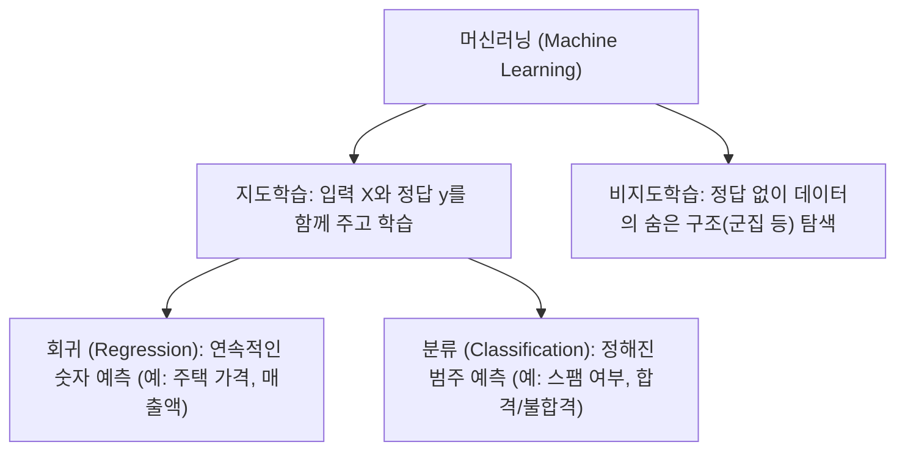

그중 입력 특성(독립변수 $x$)이 단 1개이고, 출력 타깃(종속변수 $y$)과의 관계를 1차 직선 함수로 모형화하는 가장 기초적인 지도학습 알고리즘이 **단순 선형 회귀**(Simple Linear Regression)이다.

---

### 5.2. 선형 회귀의 수학적 모델, 잔차(Residual)와 최소제곱법(OLS)

단순 선형 회귀 모델이 학습하려는 가설 함수(직선 방정식)는 다음과 같다. 여기서 모자를 씌운 $\hat{y}$은 실제값이 아닌 모델의 **예측값**을 의미한다.

$$\hat{y} = wx + b$$

- **$w$ (기울기 또는 가중치, Weight)**: 입력 $x$가 1단위 증가할 때 예측값 $\hat{y}$이 얼마나 변하는지 나타내는 민감도이다.
- **$b$ (절편 또는 편향, Bias)**: $x = 0$일 때의 기준값이자 직선 전체를 위아래로 평행 이동시키는 기준점이다.

여기서 이론상 참된 오차와 학습된 모델의 오차를 엄밀히 구분해야 한다.
- **오차(Error, $\varepsilon_i = y_i - f(x_i)$)**: 관찰되지 않은 진짜 모집단 함수($450x + 5000$)와 실제값의 차이이다.
- **잔차(Residual, $e_i = y_i - \hat{y}_i$)**: 우리가 데이터로부터 추정한 회귀 직선($\hat{y}_i$)과 실제 관측값($y_i$) 사이의 **세로 거리**이다.

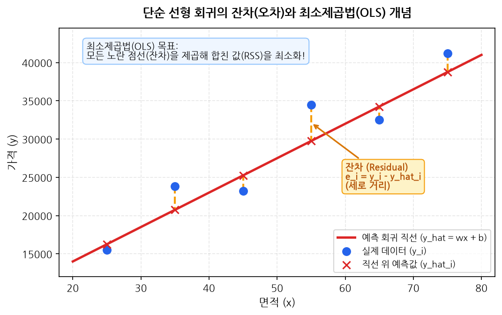

평면 위에는 무수히 많은 직선을 그을 수 있다. 이 중 가장 데이터를 잘 설명하는 단 하나의 최적 직선을 선택하기 위해, 모델은 예측이 얼마나 틀렸는지를 재는 **손실 함수**(Loss Function)를 정의하고 그 값을 최소로 만드는 $w$와 $b$를 찾는다. 선형 회귀의 표준 방법인 **최소제곱법**(Ordinary Least Squares, OLS)은 모든 데이터 점의 **잔차를 제곱해 합한 값**(잔차 제곱합, RSS)을 손실 함수로 사용하여 이를 최소화한다.

$$\text{RSS} = \sum_{i=1}^{n} (y_i - \hat{y}_i)^2 = \sum_{i=1}^{n} (y_i - (wx_i + b))^2$$

최소제곱법이 잔차를 그냥 더하거나 절댓값을 쓰지 않고 **제곱**하는 데에는 세 가지 수학적 이유가 있다.

1. **양수와 음수 오차의 상쇄 방지**: 직선 위쪽의 양의 잔차(`+1000`)와 아래쪽의 음의 잔차(`-1000`)를 부호 그대로 더하면 `0`이 되어 전혀 틀리지 않은 것처럼 왜곡된다.
2. **큰 오차에 대한 가중 페널티**: 제곱 연산은 작은 오차(`100² = 10,000`)보다 큰 오차(`1,000² = 1,000,000`)에 압도적으로 큰 벌점을 부여한다. 그 결과 모델은 크게 빗나간 점을 줄이는 방향으로 직선을 맞추려 하지만, 동시에 극단적인 이상치에 직선이 끌려가기 쉬워진다.
3. **미분 가능성과 볼록 함수 성질**: 절댓값 함수 $|y_i - \hat{y}_i|$는 `0` 지점에서 뾰족하게 꺾여 미분이 불가능하다. 반면 제곱합 함수는 모든 구간에서 매끄럽게 미분 가능한 **아래로 볼록한**(Convex) 2차 함수이므로, 편미분이 `0`이 되는 지점을 풀면 반복 탐색 없이도 **단 하나의 유일한 전역 최솟값**(해석적 해)을 수학 공식으로 즉시 구할 수 있다.

---

### 5.3. 학습(Fitting)과 추론(Prediction), 그리고 특성 행렬의 차원 원리

머신러닝 모델의 생애 주기는 크게 두 단계로 나뉜다.
- **학습(Fitting)**: 입력 데이터 `X`와 정답 `y`를 모델에 제공하여 손실 함수가 최소가 되는 내부 파라미터($w, b$)를 결정하는 과정이다.
- **추론/예측(Prediction/Inference)**: 학습으로 확정된 파라미터에 아직 정답을 모르는 새로운 입력 데이터 `new`를 대입해 $\hat{y}$을 계산하는 과정이다.

Scikit-learn을 비롯한 대부분의 머신러닝 라이브러리는 **입력 특성 `X`를 항상 2차원 행렬 `(샘플 수, 특성 수)`로, 타깃 `y`를 1차원 벡터 `(샘플 수,)`로 받는다.** 그 이유는 단순 선형 회귀($\hat{y} = w_1 x_1 + b$)뿐만 아니라 특성이 여러 개인 다중 선형 회귀($\hat{y} = w_1 x_1 + w_2 x_2 + \dots + w_p x_p + b$)까지 동일한 행렬 곱셈 구조($\hat{\mathbf{y}} = \mathbf{X}\mathbf{w} + b$)로 일반화하기 위함이다.

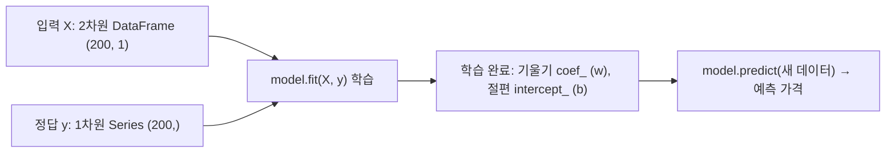

따라서 입력 특성이 `area` 1개뿐이더라도 반드시 대괄호를 두 번 써서 `office[["area"]]`와 같이 2차원 DataFrame 형태로 만들어 전달해야 한다.

| 데이터 객체 | 파이썬 코드 | 배열 형태(`shape`) | 내부 데이터 구조 예시 | 입력 `X` 사용 가능 여부 |
| :--- | :--- | :--- | :--- | :--- |
| **1차원 Series** | `office["area"]` | `(200,)` | `[67.4, 65.0, 81.2, ...]` | **불가** (차원 오류 발생) |
| **2차원 DataFrame** | `office[["area"]]` | `(200, 1)` | `[[67.4], [65.0], [81.2], ...]` | **가능** (`200행 1열` 행렬) |

Scikit-learn은 사용자가 학습 전에 설정하는 하이퍼파라미터와 구분하기 위해, **`fit()` 학습 과정을 거쳐 데이터로부터 추정된 속성 이름 끝에는 항상 밑줄(`_`)을 붙이는 규칙**을 따른다. 다중 특성을 지원하므로 기울기 `coef_`는 특성 개수 길이의 1차원 배열로 저장되며, 단일 특성 회귀에서는 첫 번째 원소 `model.coef_[0]`을 조회한다.

```python
from sklearn.linear_model import LinearRegression

model = LinearRegression()
X = office[["area"]]
y = office["price"]
model.fit(X, y)

print(f"기울기 w = {model.coef_[0]} 정답: 450")     # 439.45870417134705
print(f"절편 b = {model.intercept_} 정답: 5000")   # 5926.680580056112

new = pd.DataFrame({"area": [33, 59]})
print(model.predict(new).round(-1))                # array([20430., 31850.])
```

새로운 데이터 예측 시에도 학습 때 사용한 것과 동일한 열 이름(`"area"`)을 가진 2차원 DataFrame을 전달한다. 학습된 직선 식에 면적 `33㎡`와 `59㎡`를 대입해 검산하면 다음과 같이 일치한다.
- $33\text{㎡}$: $439.4587 \times 33 + 5926.6806 \approx 20,428.82 \rightarrow$ 일의 자리 반올림 시 `20,430`만 원
- $59\text{㎡}$: $439.4587 \times 59 + 5926.6806 \approx 31,854.74 \rightarrow$ 일의 자리 반올림 시 `31,850`만 원

---

### 5.4. 이상치의 지렛대 효과(Leverage): 학습 결과가 정답과 다른 이유

데이터 생성 시 부여한 진짜 파라미터는 $w = 450$, $b = 5000$이지만, 최소제곱법이 학습한 파라미터는 $w \approx 439.46$, $b \approx 5926.68$로 나타났다. 이 차이가 발생하는 원인은 두 가지이다.

1. **유한 표본의 랜덤 노이즈**: 200개의 샘플에 표준편차 `2,500`만 원의 정규분포 잡음이 섞여 있으므로, 표본만으로는 모집단의 참된 기울기와 절편을 100% 정확히 복원할 수 없다.
2. **이상치가 직선을 끌어당기는 지렛대 효과(Leverage)**: 최소제곱법은 오차를 제곱해 합산하므로, 직선에서 멀리 떨어진 소수의 이상치에 매우 큰 영향력을 부여한다. 뽑힌 특이 매물 5건 `[53, 13, 2, 92, 71]`의 면적은 `#13(22.75㎡)`, `#53(28.76㎡)`, `#71(40.43㎡)`, `#92(56.59㎡)`, `#2(81.22㎡)`으로, **5건 중 3건이 저면적 및 중면적 구간 위쪽에 위치**한다. 최소제곱법이 이 왼쪽 구간의 거대한 양의 오차를 줄이기 위해 직선의 왼쪽 끝을 위로 들어 올렸고, 그 결과 시소처럼 **절편 `b`는 `5000`에서 `5926.68`로 높아지고 기울기 `w`는 `450`에서 `439.46`으로 살짝 완만해졌다.**

---

### 5.5. 회귀 직선 시각화와 데이터 정렬의 원리

학습된 직선을 산점도 위에 겹쳐 그릴 때는 `line = X.sort_values("area")`처럼 **X축 값 기준으로 먼저 오름차순 정렬**한 뒤 예측값(`line_pred`)을 구해 `plt.plot()`에 전달한다.

선 그래프 함수 `plt.plot(x, y)`는 전달된 배열의 `0번 -> 1번 -> 2번 -> ...` 순서대로 점과 점을 선분으로 직결한다. 면적이 무작위로 섞인 상태에서 선을 그리면 선분이 좌우를 무질서하게 왕복하며 겹쳐 그려지고(특히 곡선 회귀에서는 완전히 망가진 빗금 그림이 나온다), 정렬된 데이터로 그려야 왼쪽에서 오른쪽으로 매끄럽게 이어진 선을 얻을 수 있다. 참고로 `scatter`와 `plot`에 `label`을 지정하더라도 `plt.legend()`를 호출하지 않으면 범례가 출력되지 않으므로 범례 표시가 필요할 때는 `plt.show()` 직전에 `plt.legend()`를 포함해야 한다.

```python
y_pred = model.predict(X)
line = X.sort_values("area")
line_pred = model.predict(line)
```

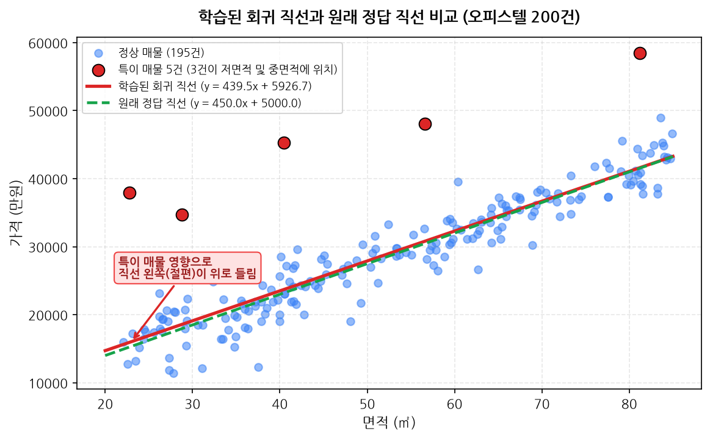

위 그림에서 붉은 실선(학습된 회귀 직선)이 초록 점선(원래 정답 직선)에 비해 왼쪽 면적 구간에서 위쪽으로 미세하게 들려 있는 현상이 바로 특이 매물의 지렛대 효과를 시각적으로 보여 준다.

---

## 6. 회귀 모델 평가 지표의 원리와 해석

모델 학습이 끝나면 "모델이 예측을 얼마나 정확하게 수행하는가"를 정량적 점수로 채점해야 한다. 회귀 문제에서는 단일 절대 기준이 존재하지 않으며, **오차의 크기를 어떤 관점에서 집계하느냐**에 따라 서로 다른 네 가지 핵심 평가 지표를 목적에 맞게 함께 해석한다.

### 6.1. 오차 분포와 평가 지표 선택의 중요성

두 모델 A와 B가 각각 세 건을 예측하여 다음과 같은 절대 오차를 기록했다고 가정하자.
- **모델 A의 오차**: `[10, 10, 10]` (매번 고르게 10씩 오차 발생)
- **모델 B의 오차**: `[0, 0, 30]` (두 건은 완벽하게 맞혔으나 한 건에서 30만큼 크게 빗나감)

| 지표 | 모델 A (`10, 10, 10`) 계산 | 모델 B (`0, 0, 30`) 계산 | 해석 |
| :--- | :--- | :--- | :--- |
| **MAE** (절댓값 평균) | $(10 + 10 + 10) / 3 = 10.0$ | $(0 + 0 + 30) / 3 = 10.0$ | 두 모델이 **동일한 성능**으로 평가된다. |
| **MSE** (제곱 평균) | $(10^2 + 10^2 + 10^2) / 3 = 100.0$ | $(0^2 + 0^2 + 30^2) / 3 = 300.0$ | 모델 B의 페널티가 **3배** 커진다. |
| **RMSE** ($\sqrt{\text{MSE}}$) | $\sqrt{100} = 10.0$ | $\sqrt{300} \approx 17.3$ | 큰 실수가 있는 모델 B를 **더 나쁘게** 본다. |

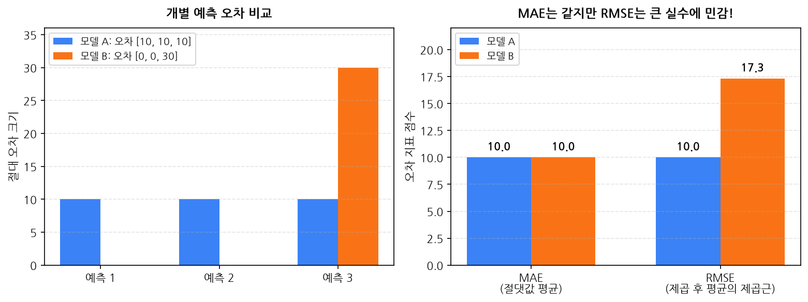

이처럼 평균적인 오차 합계가 같더라도 **대형 오차를 얼마나 치명적으로 취급할 것인가**에 따라 평가 지표의 선택이 달라진다.

---

### 6.2. 절대 오차 기반 지표: MAE (Mean Absolute Error)

**MAE**(평균 절대 오차)는 모든 관측치의 잔차 절댓값($|y_i - \hat{y}_i|$)을 산술 평균한 값이다(수학적으로 L1 노름에 기반한 오차이다).

$$\text{MAE} = \frac{1}{n} \sum_{i=1}^{n} |y_i - \hat{y}_i|$$

- **단위와 직관성**: 타깃 변수와 **동일한 단위**(만원)를 그대로 유지한다. 가상 오피스텔 데이터 200건의 MAE는 `2,493`만 원(정밀값 `2,492.504`)으로, "이 모델의 예측값은 실제 시세와 평균적으로 약 2,493만 원 정도 차이 난다"라고 바로 해석된다.
- **이상치에 대한 강건성(Robustness)**: 모든 오차에 크기와 비례하는 선형(1제곱) 가중치를 부여하므로, 소수의 극단적인 오차가 섞여 있어도 지표 값이 과도하게 흔들리지 않는다.

---

### 6.3. 제곱 오차 기반 지표: MSE와 RMSE

**MSE**(평균 제곱 오차)는 잔차를 제곱하여 평균 낸 지표이다(L2 노름의 제곱 기반 오차이다).

$$\text{MSE} = \frac{1}{n} \sum_{i=1}^{n} (y_i - \hat{y}_i)^2$$

MSE는 미분이 가능해 모델 학습 시 손실 함수로 최적의 성질을 지니지만, 단위가 **제곱 단위**(만원²)로 팽창한다는 단점이 있다. 오피스텔 데이터에서 계산된 `16,240,971`만 원² 같은 거대한 숫자는 모델 간 상대 비교에는 쓸 수 있어도 직관적 감을 잡기 어렵다.

이를 보완하기 위해 MSE에 양의 제곱근($\sqrt{\phantom{x}}$)을 씌워 **원래 단위**(만원)로 되돌린 지표가 **RMSE**(평균 제곱근 오차)이다. Scikit-learn 1.4 버전부터는 `root_mean_squared_error` 함수로 직접 계산할 수 있다.

$$\text{RMSE} = \sqrt{\text{MSE}} = \sqrt{\frac{1}{n} \sum_{i=1}^{n} (y_i - \hat{y}_i)^2}$$

- **실습 결과**: 오피스텔 200건의 RMSE는 `4,030`만 원(정밀값 `4,030.009`)이다.
- **부등식 $\text{RMSE} \ge \text{MAE}$의 진단적 의미**: 코시-슈바르츠 부등식(또는 젠센 부등식)에 의해 모든 데이터에서 항상 $\text{RMSE} \ge \text{MAE}$가 성립하며, 등호는 모든 데이터의 오차 크기가 정확히 같을 때만 성립한다. 이번 결과에서 **`RMSE(4,030)`가 `MAE(2,493)`보다 1.6배 이상 크게 나타난 것은, 대다수 매물의 오차는 작더라도 소수 매물에서 매우 거대한 오차(이상치)가 발생하고 있다는 강력한 통계적 신호**이다.

---

### 6.4. 상대적 설명력 지표: 결정계수($R^2$)의 구조와 음수 조건

MAE와 RMSE는 단위가 그대로 남아 있어 데이터 규모가 다른 두 문제를 비교하기 어렵다. 예를 들어 집값(억 원 단위)에서 오차 500만 원은 매우 정확하지만, 점심값(만 원 단위)에서 오차 500만 원은 완전히 틀린 것이다.

이를 해결하기 위해 **"아무 입력 변수도 쓰지 않고 무조건 타깃의 평균($\bar{y}$)만 예측하는 가장 단순한 기준 모델(Baseline Model)과 비교하여, 우리 모델이 데이터의 총 변동을 얼마나 설명해 내는가"를** 비율로 나타낸 지표가 **결정계수**($R^2$, Coefficient of Determination)이다.

$$R^2 = 1 - \frac{\text{SSE}}{\text{SST}} = 1 - \frac{\sum_{i=1}^{n} (y_i - \hat{y}_i)^2}{\sum_{i=1}^{n} (y_i - \bar{y})^2}$$

- **$\text{SST}$ (Total Sum of Squares, 총 제곱합)**: 실제값들이 평균 $\bar{y}$로부터 흩어져 있는 총 변동량(평균 기준 모델의 오차 제곱합)이다.
- **$\text{SSE}$ (Residual/Error Sum of Squares, 잔차 제곱합)**: 우리 회귀 모델이 예측하고도 여전히 남아 있는 오차 제곱합이다.

실제 집값 3개가 `[100, 200, 300]`(평균 $\bar{y} = 200$, $\text{SST} = (100-200)^2 + (200-200)^2 + (300-200)^2 = 20,000$)일 때 세 가지 극단적 예측 사례를 대입하면 $R^2$의 점수 범위가 명쾌하게 이해된다.

1. **완벽한 예측 `[100, 200, 300]`**: 남은 오차가 없으므로 $\text{SSE} = 0$, $R^2 = 1 - 0/20000 = \mathbf{1.0}$ (이론상 최댓값)이다.
2. **평균 예측 `[200, 200, 200]`**: 기준 모델과 오차가 똑같으므로 $\text{SSE} = 20,000$, $R^2 = 1 - 20000/20000 = \mathbf{0.0}$이다.
3. **완전히 반대 방향 예측 `[300, 200, 100]`**: $\text{SSE} = (100-300)^2 + 0 + (300-100)^2 = 80,000$, $R^2 = 1 - 80000/20000 = \mathbf{-3.0}$ (**음수**)이 된다.

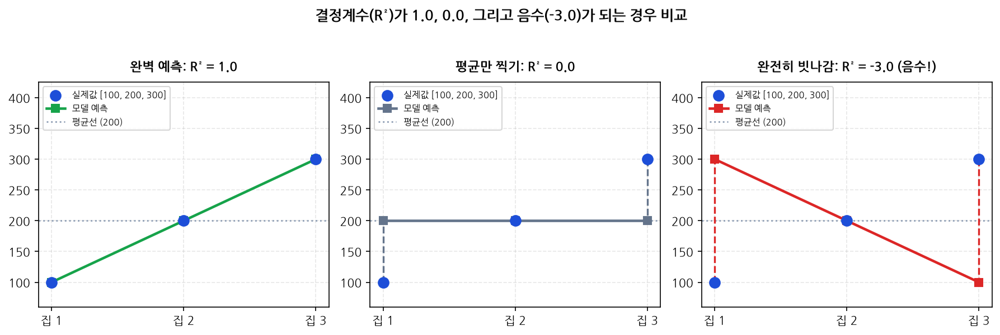

즉, 모델의 예측 오차가 **단순히 전체 평균으로 찍었을 때의 오차보다도 더 크다면** $\text{SSE} > \text{SST}$가 되어 $R^2$는 얼마든지 **음수**가 될 수 있다(특히 테스트 데이터에 잘못 일반화된 모델에서 자주 나타난다).

오피스텔 데이터 200건의 결정계수는 `0.803` (`0.8034`)으로, 면적(`area`) 하나의 선형 회귀 직선만으로 전체 가격 변동의 약 **80.3%를** 설명한다. 또한 입력 변수가 1개인 **단순 선형 회귀의 학습 데이터**에서는 수학적으로 결정계수 $R^2$가 피어슨 상관계수의 제곱($r^2$)과 정확히 일치한다($0.8963336^2 \approx 0.8034$). 단, 다중 선형 회귀나 비선형 모델, 혹은 학습에 쓰지 않은 테스트 데이터에서는 이 등식이 일반 성립하지 않는다.

---

### 6.5. 4대 회귀 지표 총정리와 파이썬 계산 및 출력 서식

| 지표 | 수식 핵심 | 단위 | 최적 방향 | 이상치 민감도 | 200건 실제 결과 |
| :--- | :--- | :--- | :--- | :--- | :--- |
| **MAE** | 절댓값의 평균 | 원래 단위(만원) | `0`에 가까울수록 우수 | 낮음(선형 반영) | `2,493` (`2,492.504`) |
| **MSE** | 제곱의 평균 | 제곱 단위(만원²) | `0`에 가까울수록 우수 | 매우 높음(제곱) | `16,240,971` |
| **RMSE** | MSE의 제곱근 | 원래 단위(만원) | `0`에 가까울수록 우수 | 높음(제곱 후 루트) | `4,030` (`4,030.009`) |
| **$R^2$** | $1 - \text{SSE}/\text{SST}$ | 무차원 비율 | `1`에 가까울수록 우수 | 높음(분자가 제곱합) | `0.803` (`0.8034`) |

```python
from sklearn.metrics import (
    mean_squared_error,
    mean_absolute_error,
    root_mean_squared_error,
    r2_score,
)

print(f"MAE = {mean_absolute_error(y, y_pred):,.0f}")
print(f"MSE = {mean_squared_error(y, y_pred):,.0f}")
print(f"RMSE = {root_mean_squared_error(y, y_pred):,.0f}")
print(f"R_SCORE = {r2_score(y, y_pred):,.3f}")
```

결과 출력 시 사용한 **파이썬 f-string 포매팅 지정자**의 규칙은 다음과 같다.
- `:,.0f`: 천 단위마다 쉼표(`,`)를 넣고 소수점 아래를 반올림해 정수 형태로 출력한다 (`2492.504` $\rightarrow$ `2,493`).
- `:,.3f`: 천 단위 쉼표를 넣고 소수점 셋째 자리까지 출력한다 (`2492.504` $\rightarrow$ `2,492.504`).
- `:.4f`: 쉼표 없이 소수점 넷째 자리까지 출력한다 (`0.8034`).

---

## 7. 이상치가 평가에 미치는 영향과 분리 검증

### 7.1. 이상치의 이중 영향과 분리 평가(Segmented Evaluation)

이상치는 머신러닝 파이프라인의 두 지점 모두에 강한 영향을 미친다.
1. **학습 단계**: 최소제곱법 회귀선의 기울기와 절편을 자신의 방향으로 끌어당겨 정상 데이터의 예측 정확도를 떨어뜨린다.
2. **평가 단계**: 소수의 이상치에서 발생한 거대한 잔차가 제곱되면서 MSE와 RMSE를 부풀리고 $R^2$를 급격히 끌어내린다.

따라서 모델 성능을 단일 평균 점수 하나로만 판단하기보다, **정상 집단과 특이 집단을 분리하여 각각의 지표를 확인하는 분리 평가**(Segmented Evaluation)를 수행하면 현재 모델의 약점이 보편적 예측 실패 때문인지 소수의 이상치 때문인지 진단할 수 있다.

---

### 7.2. 불리언 마스크(Boolean Mask)의 개념과 구현 원리

전체 데이터에서 특정 인덱스만 제외하고 정상 데이터만 선택하는 효율적인 기법이 **불리언 마스크**(Boolean Mask)이다. 이는 데이터 길이와 똑같은 크기의 논리값 배열을 만들어, 포함할 위치는 `True`, 가릴 위치는 `False`로 지정하는 필터 구조이다.

초기 마스크를 만들 때 사용하는 `np.ones(개수, dtype=...)` 함수는 지정한 크기만큼 숫자 `1`로 채워진 배열을 생성하며, `dtype` 인자에 따라 자료형이 달라진다.
- `np.ones(5)` $\rightarrow$ `array([1., 1., 1., 1., 1.])` (기본값 `float64` 실수형)
- `np.ones(5, dtype=int)` $\rightarrow$ `array([1, 1, 1, 1, 1])` (`int` 정수형)
- `np.ones(5, dtype=bool)` $\rightarrow$ `array([ True, True, True, True, True])` (`bool` 논리형, `1`이 `True`로 변환됨)

크기 5짜리 작은 배열에서 이상치 인덱스 `[1, 3]`을 제외하는 과정은 네 단계로 진행된다.

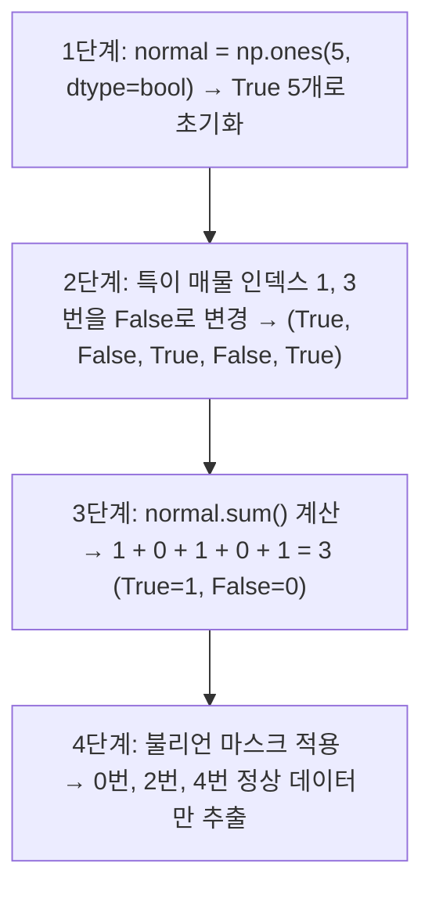

파이썬과 NumPy에서 불리언 값은 산술 연산 시 **`True`는 `1`, `False`는 `0`으로** 취급되므로, `normal.sum()`을 호출하는 것만으로 조건을 통과한 정상 매물의 개수(`195`)를 즉시 집계할 수 있다.

```python
normal = np.ones(len(office), dtype=bool)
normal[special] = False
print("특이매물", special)      # [53 13  2 92 71]
print("정상매물", normal.sum()) # 195

all_rows = np.ones(len(office), dtype=bool)
cases = [("전체 200건", all_rows), ("특이매물 제외 195건", normal)]

for name, mask in cases:
    y_true = y[mask]
    y_hat = y_pred[mask]
    mae = mean_absolute_error(y_true, y_hat)
    rmse = root_mean_squared_error(y_true, y_hat)
    r2 = r2_score(y_true, y_hat)
    print(f"{name} -> MAE: {mae:,.3f}, RMSE: {rmse:,.3f}, R2: {r2:.4f}")
```

반복문 구문 `for name, mask in cases:`는 리스트 안에 `(문자열, 불리언 배열)` 쌍으로 묶여 있는 각 튜플을 `name`과 `mask` 변수에 한 번에 풀어 대입하는 **튜플 언패킹**(Tuple Unpacking)이다. 이를 통해 Pandas Series인 `y`와 NumPy 배열인 `y_pred` 모두에서 동일한 마스크 위치만 추출(`y[mask]`, `y_pred[mask]`)하여 일관되게 비교한다.

---

### 7.3. 전체 200건 vs 특이 매물 제외 195건 비교와 실무 대응 원칙

특이 매물 5건(전체의 2.5%)을 평가 대상에서 제외했을 때의 성능 변화는 다음과 같다.

| 평가 대상 | MAE (만원) | RMSE (만원) | $R^2$ (결정계수) |
| :--- | ---: | ---: | ---: |
| **전체 200건** | `2,492.504` | `4,030.009` | `0.8034` |
| **특이매물 제외 195건** | `2,075.104` | `2,731.535` | `0.9024` |
| **변화량** | **-417.400 (약 16.7% 감소)** | **-1,298.474 (약 32.2% 감소)** | **+0.0990 (설명력 상승)** |

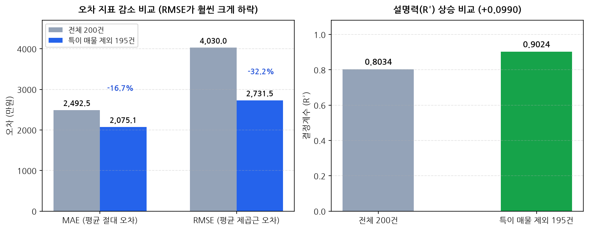

이 비교 결과는 머신러닝 모델 평가 및 이상치 대응에 있어 세 가지 중요한 시사점을 준다.

1. **소수 이상치의 압도적 영향력**: 전체 데이터의 2.5%에 불과한 5건만 제외했을 뿐인데, 모델의 설명력 $R^2$가 `0.8034`에서 `0.9024`로 크게 상승한다.
2. **RMSE 감소폭(32.2%)이 MAE 감소폭(16.7%)의 약 2배인 이유**: 5건의 특이 매물에서 발생한 `15,000` ~ `25,000`만 원 규모의 거대한 잔차가 제곱되어 RMSE를 극단적으로 키우고 있었기 때문이다. 제곱 오차 지표가 소수 이상치에 얼마나 민감하게 반응하는지 수치로 확인된다.
3. **평가 제외와 학습 전처리 및 강건 회귀의 구분**: 위 실험은 **이미 200건 전체로 학습된 모델**(`w ≈ 439.46`, `b ≈ 5926.68`)을 그대로 두고 **평가 집합에서만** 이상치를 분리한 것이다. 실무에서 테스트 시 임의로 까다로운 이상치를 빼고 좋은 점수만 보고하는 행위는 성능 과대평가를 낳으므로 금지되어야 한다. 대신 이러한 분리 검증을 통해 이상치가 모델 학습을 저해한다는 근거가 확인되면, **도메인 검증을 통한 학습 전처리**(이상치 제거/대체)나 이상치의 제곱 페널티를 완화하는 **강건 회귀**(Robust Regression, 예: `HuberRegressor`, `RANSACRegressor`) 도입을 검토하는 판단 기준으로 활용해야 한다.

---

## 8. 핵심 개념 총정리

1. **정형 데이터와 시각화**: 표 데이터는 행(샘플)과 열(특성)로 구성되며 연속형 변수와 식별자를 구분해야 한다. Matplotlib은 도화지(`Figure`)와 좌표평면(`Axes`)의 계층을 가지며, 한글과 음수 기호 깨짐을 막기 위해 `plt.rcParams`로 글꼴과 `axes.unicode_minus = False`를 설정한다.
2. **기술통계량**: 중심 경향성은 평균과 중앙값으로, 산포도는 분산과 표준편차로, 분포의 뼈대는 사분위수($Q_1, Q_2, Q_3$)와 $\text{IQR}$로 요약한다. 이상치는 평균과 최댓값을 크게 끌어당긴다.
3. **조건부 필터링과 상관분석**: 다중 조건 결합은 `&` 연산자와 소괄호 `()`를 이용한 불리언 인덱싱으로 수행한다. 피어슨 상관계수 $r$은 두 변수의 **직선 관계** 강도(`-1` ~ `+1`)만 재며, 비선형 패턴 포착 한계, 인과관계와의 구분, 교란 변수 통제 여부, 소표본 편향을 반드시 함께 검토해야 한다.
4. **확률분포와 데이터 생성**: `default_rng(시드)`는 재현 가능한 의사난수를 생성한다. 현실 데이터는 규칙적인 선형 신호($wx + b$)에 정규분포 노이즈와 소수의 이상치가 더해진 구조로 이해할 수 있다.
5. **단순 선형 회귀**: 최소제곱법(OLS)은 잔차 제곱합(RSS)을 최소화하는 유일한 직선 $\hat{y} = wx + b$를 찾는다. Scikit-learn 입력 `X`는 일반화를 위해 항상 2차원 행렬이어야 하며, 최소제곱법은 제곱 페널티 때문에 이상치의 지렛대 효과에 민감하다.
6. **회귀 평가 지표**: `MAE`는 직관적인 평균 절대 오차, `MSE`는 최적화에 쓰이는 제곱 오차, `RMSE`는 큰 오차에 민감한 원래 단위의 오차이며 $\text{RMSE} \ge \text{MAE}$의 큰 격차는 이상치 존재를 시사한다. $R^2$는 평균 기준 모델 대비 상대 설명력으로, 평균 예측보다도 오차가 크면 음수가 된다.
7. **불리언 마스크 분리 검증**: `np.ones(..., dtype=bool)`과 팬시 인덱싱으로 정상 데이터와 이상치를 분리 평가하면 소수 이상치가 오차 지표에 미치는 영향을 정량적으로 진단하고 전처리 또는 강건 회귀 도입 여부를 결정할 수 있다.
